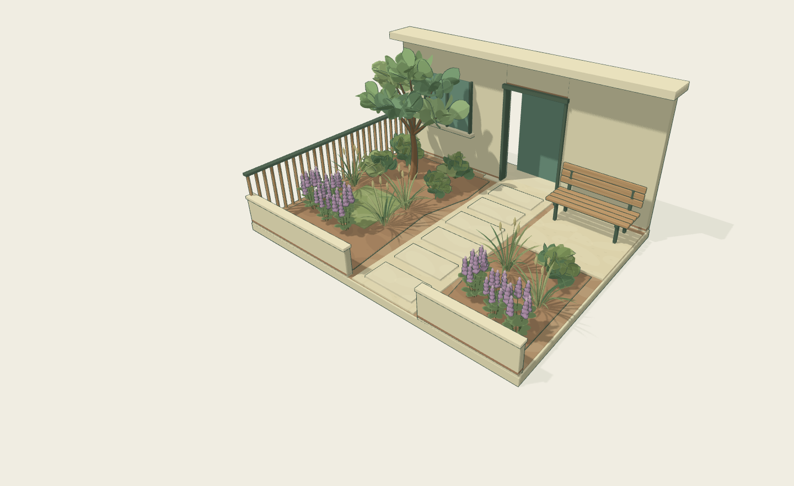

# OWOL Garden V4

선택하신 왼쪽 식물 표현을 복원하고, 식재영역 윤곽 편집과 저장·불러오기·되돌리기를 연결한 오월 정원 체험 시제품입니다.

## 다운로드

| 파일 | 용도 |
| --- | --- |
| [실행 ZIP · 2.4 MB](https://github.com/aelandscapeinfo-design/garden/raw/refs/heads/codex/owol-v4-download-20261016/OWOL-garden-v4-run.zip) | 실행에 필요한 HTML, 서버 실행기, 안내, 비교 화면, 라이선스 |
| [전체 소스 ZIP · 19 MB](https://github.com/aelandscapeinfo-design/garden/raw/refs/heads/codex/owol-v4-download-20261016/OWOL-garden-v4-source.zip) | 소스 코드, 의존성 잠금 파일, 테스트, 빌드, 화면 캡처, 검증 문서 |

링크 대신 파일 목록에서 ZIP을 열고 **Download raw file** 버튼으로 받아도 됩니다. 저장소에 접근할 수 있는 GitHub 계정으로 로그인하세요.

## 실행

1. Node.js 24가 설치된 컴퓨터에서 실행 ZIP을 완전히 압축 해제합니다.
2. Windows에서는 `START-ART-WINDOWS.cmd`를 실행합니다. 또는 압축 해제한 폴더의 터미널에서 `node serve.mjs`를 실행합니다.
3. 서버 창에 표시된 주소를 **같은 컴퓨터**의 Chrome 또는 Edge에서 엽니다. 실행 중에는 서버 창을 열어 두세요.

실행 ZIP에는 필요한 코드가 포함되어 있어 npm 설치나 유료 API, 외부 계정이 필요 없습니다. `review.html`에서 같은 시점의 표현 비교와 화단 편집 화면을 볼 수 있습니다. 자세한 설명은 ZIP 안의 `먼저 읽어주세요.txt`를 확인하세요.

## 실제 화면

## 검증과 범위

- 공간·저장 관련 Node 테스트 23개와 Chromium 브라우저 시나리오 14개를 통과했습니다. 마지막 새 영역 그리기 수정 후 관련 브라우저 시나리오 2개를 다시 확인했습니다.
- 배치·이동·회전·삭제·되돌리기, 저장 복원, PNG 내보내기, 화단 윤곽 편집과 모바일 크기의 터치 조작을 검사했습니다.
- 실제 휴대폰, Windows 실행기, HTML 파일 직접 열기는 검증하지 않았습니다. 검증 환경은 Linux Chromium과 HTTP 실행입니다.
- 소프트웨어 GPU 측정에서 약 3.7 fps였습니다. 휴대폰 또는 일반 GPU의 성능을 보장하지 않습니다. 상세 측정 조건은 `VALIDATION.md`에 있습니다.
- 카툰 식물 표현은 첫 앞마당 6 × 4.5 m의 4유형에 적용되어 있습니다. 다른 맵은 이전 표현을 유지합니다.
- 실제 상담 전송·회원가입·결제·서버 연결은 없습니다. 저장 데이터는 브라우저 내부에 보관되며 JSON으로 내보낼 수 있습니다.
- 실제 식재와 시공은 현장 조건과 전문가 검토가 필요합니다.

직접 제작한 모델·재료와 공식 참고 코드의 출처·라이선스는 ZIP 안의 `ASSETS.md`와 `THIRD-PARTY-NOTICES.txt`에 정리했습니다. 다운로드 파일의 SHA-256은 `OWOL-garden-v4-SHA256SUMS.txt`에 있습니다.
