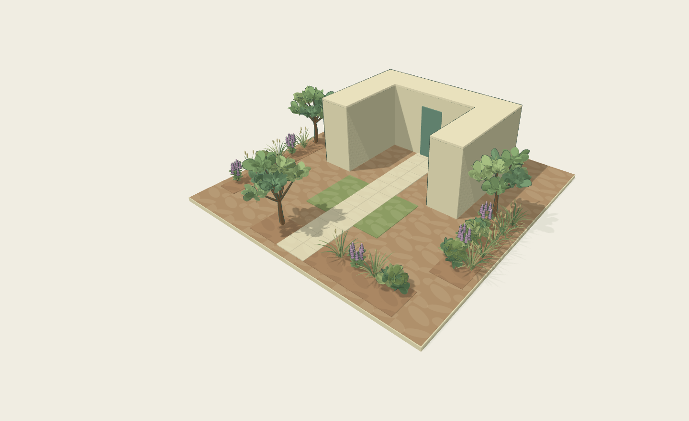

# OWOL Garden V5 · 나의 정원 구성

선택한 V4 식물·색·빛과 기존 카메라는 유지하고, 빈 땅에서 화단·잔디·포장·집을 직접 구성하도록 개선했습니다. 같은 시점의 V4/V5 기준 장면 PNG는 바이트까지 동일합니다. 면 편집과 실제 장면, 배치 판정, 저장 데이터를 함께 연결했습니다.

## 다운로드와 실행

**실행만 하려면 실행 ZIP 하나를 받으세요.** 소스 ZIP은 코드를 수정할 때 사용합니다.

| 파일 | 내용 |
| --- | --- |
| [실행 ZIP · 약 5.1 MB](https://github.com/aelandscapeinfo-design/garden/raw/refs/heads/codex/owol-v5-composition-20261016/OWOL-garden-v5-run.zip) | HTML, 실행기, 안내, 실제 비교 화면 10장, 저장 예시, 라이선스 |
| [전체 소스 ZIP · 약 23.1 MB](https://github.com/aelandscapeinfo-design/garden/raw/refs/heads/codex/owol-v5-composition-20261016/OWOL-garden-v5-source.zip) | 위 실행본과 대응하는 소스·빌드·테스트·실측·검증 자료 |

파일 화면의 **Download raw file** 버튼으로 받아도 됩니다. 저장소 접근 권한이 필요한 경우 연결한 GitHub 계정으로 로그인하세요.

1. Node.js 24가 설치된 컴퓨터에서 실행 ZIP을 완전히 압축 해제합니다.
2. Windows는 `START-ART-WINDOWS.cmd`, 또는 압축을 푼 폴더에서 `node serve.mjs`를 실행합니다.
3. 표시되는 `http://127.0.0.1:5183`을 **서버를 실행한 같은 컴퓨터**의 Chrome/Edge에서 엽니다. 실행 중 서버 창을 열어두세요.

npm 설치·유료 API·외부 계정이 필요 없는 로컬 앱입니다. 위 localhost 주소는 이 저장소의 온라인 미리보기가 아닙니다. ZIP 안의 `review.html`은 실행 전에도 볼 수 있는 실제 화면 비교 자료입니다.

## 실제 V5 화면

## 실제 연결한 변경

- **빈 땅**: 식물·화단·포장·건물 0개. 치수 변경과 새로고침 후 복구.
- **화단과 바닥**: 사각/원형 연속 브러시, 늘리기·줄이기·구멍, 이동·복제·합치기·종류 전환, 독립 플랜터. 획 되돌리기와 문서 되돌리기 분리.
- **보존**: 영역 밖 식물은 ID와 좌표를 유지해 이동 대기함에 보관. V5 별도 저장 키와 JSON 왕복. V2/V3/V4 원본 슬롯 보존.
- **건물**: 실제 사각·ㄱ·ㄷ footprint, 치수·높이·회전·반전·벽을 따르는 출입문. 10가지 실제 기본 구성과 선택적 예시 식물.
- **포장·분류**: 재료와 패턴·방향·모듈 분리, 구멍에서 패턴 잘림. 기존 식물의 다중 필터·검색과 모델 참조 ID 기록.

**Node 검사 39개, 단일 HTML 브라우저 시나리오 23개 통과.** 배치·이동·회전·삭제·되돌리기·저장 복원·PNG, 실제 마우스와 모바일 크기의 터치 입력을 검사했습니다. Windows 실행기와 실제 휴대폰은 직접 검증하지 않았습니다. 클라우드 SwiftShader 실측은 약 3.5fps였으며, 실제 GPU/휴대폰 성능을 보장하지 않습니다.

분리된 식재 섬은 하나의 논리 영역으로 함께 선택됩니다. 새로운 패치의 꼭짓점 편집, 식물 동반 영역 이동, 자유 CAD 건물 편집은 남아 있습니다. 새 모델 없이 V4 카툰 4유형과 보존한 V3 전용 3유형을 구분하며, 검증된 품종/생육 DB는 연결하지 않았습니다.

[상세 실행·조작 안내](owol-garden-v5/README.md) · [실제 검수·성능·한계](owol-garden-v5/VALIDATION.md) · [출처·라이선스](owol-garden-v5/ASSETS.md) · [저장 예시](owol-garden-v5/examples) · [다운로드 SHA-256](OWOL-garden-v5-SHA256SUMS.txt)

기존 V4 원본은 [V4 전달 브랜치](https://github.com/aelandscapeinfo-design/garden/tree/codex/owol-v4-download-20261016)에 보존되어 있습니다. 실제 상담 전송·회원가입·결제·외부 서비스 배포는 없습니다. 실제 식재와 시공은 현장 조건과 전문가 검토가 필요합니다.
